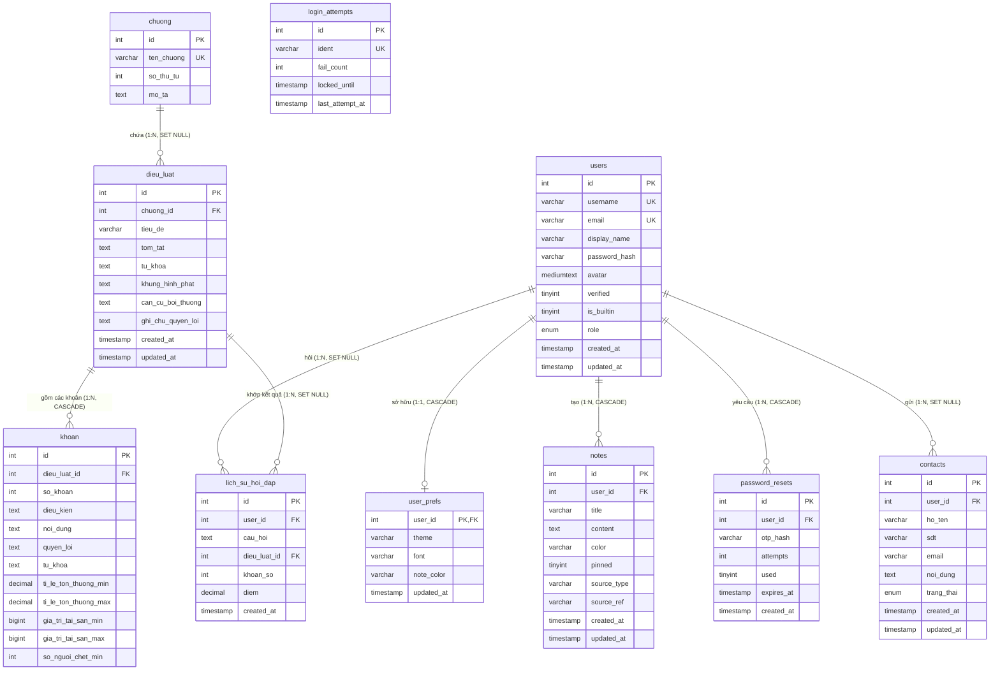

# TÀI LIỆU THIẾT KẾ CƠ SỞ DỮ LIỆU — HÌNH SỰ TRA CỨU

> **Phiên bản:** 1.0 (Phase 1 — Task T13 + F06)  
> **Người phụ trách:** kajima (TV-A)  
> **Hệ quản trị CSDL:** MySQL 8.0+ / MariaDB 10.4+ (XAMPP)  
> **Bảng mã / Đối chiếu:** `utf8mb4` / `utf8mb4_unicode_ci`  
> **Storage Engine:** `InnoDB` (Hỗ trợ khóa ngoại và giao dịch ACID)

---

## 1. Tổng quan kiến trúc CSDL

Cơ sở dữ liệu `hinh_su_db` được thiết kế phục vụ ứng dụng web tra cứu và tư vấn thông tin Bộ luật Hình sự Việt Nam. Hệ thống bao gồm 10 bảng dữ liệu được chuẩn hóa, chia thành 3 phân hệ chính:

1. **Phân hệ Người dùng & Xác thực:**
   - `users`: Tài khoản người dùng và quản trị viên, phân quyền (`role`), cờ bảo vệ tài khoản mặc định (`is_builtin`).
   - `user_prefs`: Cấu hình giao diện cá nhân (chủ đề dark/light/system, cỡ chữ, màu ghi chú).
   - `login_attempts`: Theo dõi số lần đăng nhập thất bại phục vụ cơ chế rate limiting và khóa tài khoản tạm thời phía server.
   - `password_resets`: Quản lý yêu cầu đặt lại mật khẩu bằng mã OTP lưu tại server.

2. **Phân hệ Ghi chú & Tương tác:**
   - `notes`: Ghi chú cá nhân của người dùng, liên kết trực tiếp tới điều luật hoặc câu tư vấn chatbot.
   - `contacts`: Hộp thư liên hệ, câu hỏi góp ý từ người dùng gửi đến ban quản trị.
   - `lich_su_hoi_dap`: Nhật ký hỏi đáp giữa người dùng và chatbot NLU, phục vụ thống kê và huấn luyện câu hỏi.

3. **Phân hệ Tri thức Pháp luật:**
   - `chuong`: Danh mục các chương của Bộ luật Hình sự.
   - `dieu_luat`: Chi tiết các điều luật (tội danh, tóm tắt, từ khóa, khung hình phạt tổng quan, căn cứ bồi thường).
   - `khoan`: Các khoản định khung hình phạt chi tiết, kèm các tiêu chí định lượng (tỉ lệ tổn thương, giá trị tài sản, số người chết) và quyền lợi của người bị hại.

---

## 2. Sơ đồ thực thể liên kết (ERD)



---

## 3. Mô tả chi tiết từng bảng và cột dữ liệu

### 3.1. Bảng `users` (Người dùng)
Lưu trữ thông tin tài khoản, mật khẩu băm và phân quyền hệ thống.

| Tên cột | Kiểu dữ liệu | Ràng buộc | Mặc định | Mô tả nghiệp vụ |
|---|---|---|---|---|
| `id` | `INT` | PK, AUTO_INCREMENT | — | Mã định danh người dùng duy nhất |
| `username` | `VARCHAR(50)` | UNIQUE, NULL | `NULL` | Tên đăng nhập (dành cho demo/admin hoặc mở rộng) |
| `email` | `VARCHAR(255)` | UNIQUE, NOT NULL | — | Địa chỉ email đăng nhập chính thức |
| `display_name` | `VARCHAR(100)` | NOT NULL | — | Tên hiển thị công khai của người dùng (2–40 ký tự) |
| `password_hash` | `VARCHAR(255)` | NOT NULL | — | Mật khẩu băm chuẩn `PASSWORD_BCRYPT` (60 ký tự) |
| `avatar` | `MEDIUMTEXT` | NULL | `NULL` | Ảnh đại diện (DataURL Base64 ảnh JPEG 256×256) |
| `verified` | `TINYINT(1)` | NOT NULL | `0` | Trạng thái xác thực email (0: Chưa, 1: Đã xác thực) |
| `is_builtin` | `TINYINT(1)` | NOT NULL | `0` | Cờ bảo vệ tài khoản hệ thống (1: Demo, cấm xóa/sửa) |
| `role` | `ENUM('user','admin')` | NOT NULL | `'user'` | Vai trò truy cập hệ thống: user thường hoặc admin |
| `created_at` | `TIMESTAMP` | NOT NULL | `CURRENT_TIMESTAMP` | Thời điểm đăng ký tài khoản |
| `updated_at` | `TIMESTAMP` | NOT NULL | `CURRENT_TIMESTAMP ON UPDATE` | Thời điểm cập nhật hồ sơ gần nhất |

---

### 3.2. Bảng `user_prefs` (Tùy chọn giao diện)
Lưu cấu hình giao diện người dùng. Có quan hệ 1-1 với bảng `users`.

| Tên cột | Kiểu dữ liệu | Ràng buộc | Mặc định | Mô tả nghiệp vụ |
|---|---|---|---|---|
| `user_id` | `INT` | PK, FK -> `users(id)` | — | Khóa chính đồng thời là khóa ngoại, **ON DELETE CASCADE** |
| `theme` | `VARCHAR(20)` | NOT NULL | `'system'` | Chủ đề giao diện: `'system'`, `'light'`, `'dark'` |
| `font` | `VARCHAR(10)` | NOT NULL | `'md'` | Kích thước phông chữ: `'sm'`, `'md'`, `'lg'`, `'xl'` |
| `note_color` | `VARCHAR(20)` | NOT NULL | `'yellow'` | Màu thẻ ghi chú ưu tiên: `'yellow'`, `'blue'`, `'green'`, `'red'`, `'purple'` |
| `updated_at` | `TIMESTAMP` | NOT NULL | `CURRENT_TIMESTAMP ON UPDATE` | Thời điểm cập nhật tùy chọn |

---

### 3.3. Bảng `notes` (Ghi chú cá nhân)
Lưu danh sách ghi chú do người dùng tạo trong quá trình tra cứu.

| Tên cột | Kiểu dữ liệu | Ràng buộc | Mặc định | Mô tả nghiệp vụ |
|---|---|---|---|---|
| `id` | `INT` | PK, AUTO_INCREMENT | — | Mã định danh ghi chú |
| `user_id` | `INT` | FK -> `users(id)`, NOT NULL | — | Chủ sở hữu ghi chú, **ON DELETE CASCADE** |
| `title` | `VARCHAR(255)` | NOT NULL | — | Tiêu đề ghi chú (giới hạn validate ≤ 120 ký tự) |
| `content` | `TEXT` | NULL | `NULL` | Nội dung chi tiết (giới hạn validate ≤ 5000 ký tự) |
| `color` | `VARCHAR(20)` | NOT NULL | `'yellow'` | Màu sắc thẻ hiển thị trên giao diện |
| `pinned` | `TINYINT(1)` | NOT NULL | `0` | Trạng thái ghim lên đầu danh sách (1: Ghim, 0: Thường) |
| `source_type` | `VARCHAR(50)` | NULL | `NULL` | Loại nguồn tạo: `'article'` (điều luật), `'chat'` (tư vấn), `'manual'` |
| `source_ref` | `VARCHAR(50)` | NULL | `NULL` | Mã tham chiếu nguồn (ví dụ: số điều `'134'`) |
| `created_at` | `TIMESTAMP` | NOT NULL | `CURRENT_TIMESTAMP` | Thời điểm tạo ghi chú |
| `updated_at` | `TIMESTAMP` | NOT NULL | `CURRENT_TIMESTAMP ON UPDATE` | Thời điểm chỉnh sửa ghi chú |

---

### 3.4. Bảng `contacts` (Liên hệ & Góp ý)
Lưu thông tin và nội dung liên hệ từ người dùng gửi cho ban quản trị.

| Tên cột | Kiểu dữ liệu | Ràng buộc | Mặc định | Mô tả nghiệp vụ |
|---|---|---|---|---|
| `id` | `INT` | PK, AUTO_INCREMENT | — | Mã định danh liên hệ |
| `user_id` | `INT` | FK -> `users(id)`, NULL | `NULL` | ID người dùng gửi tin (NULL nếu khách vãng lai), **ON DELETE SET NULL** |
| `ho_ten` | `VARCHAR(100)` | NOT NULL | — | Họ và tên người gửi (2–60 ký tự) |
| `sdt` | `VARCHAR(25)` | NULL | `NULL` | Số điện thoại liên lạc (chuẩn định dạng quốc tế/nội địa) |
| `email` | `VARCHAR(255)` | NOT NULL | — | Email phản hồi |
| `noi_dung` | `TEXT` | NOT NULL | — | Nội dung thắc mắc / góp ý (10–2000 ký tự) |
| `trang_thai` | `ENUM('moi','da_tra_loi')` | NOT NULL | `'moi'` | Tiến độ xử lý của ban quản trị |
| `created_at` | `TIMESTAMP` | NOT NULL | `CURRENT_TIMESTAMP` | Thời điểm gửi liên hệ |
| `updated_at` | `TIMESTAMP` | NOT NULL | `CURRENT_TIMESTAMP ON UPDATE` | Thời điểm quản trị viên cập nhật trạng thái |

---

### 3.5. Bảng `login_attempts` (Đăng nhập thất bại)
Cơ chế bảo vệ chống tấn công dò mật khẩu (Brute Force).

| Tên cột | Kiểu dữ liệu | Ràng buộc | Mặc định | Mô tả nghiệp vụ |
|---|---|---|---|---|
| `id` | `INT` | PK, AUTO_INCREMENT | — | Mã định danh dòng |
| `ident` | `VARCHAR(255)` | UNIQUE, NOT NULL | — | Tên tài khoản, email hoặc IP thực hiện đăng nhập |
| `fail_count` | `INT` | NOT NULL | `0` | Số lần đăng nhập sai liên tiếp (ngưỡng khóa = 5) |
| `locked_until` | `TIMESTAMP` | NULL | `NULL` | Thời điểm hết hạn khóa tài khoản (khóa tạm 60 giây) |
| `last_attempt_at` | `TIMESTAMP` | NOT NULL | `CURRENT_TIMESTAMP ON UPDATE` | Thời điểm thử đăng nhập gần nhất |

---

### 3.6. Bảng `password_resets` (Đặt lại mật khẩu)
Quản lý mã OTP đặt lại mật khẩu với thời hạn 15 phút và tối đa 5 lần thử.

| Tên cột | Kiểu dữ liệu | Ràng buộc | Mặc định | Mô tả nghiệp vụ |
|---|---|---|---|---|
| `id` | `INT` | PK, AUTO_INCREMENT | — | Mã định danh giao dịch OTP |
| `user_id` | `INT` | FK -> `users(id)`, NOT NULL | — | Người yêu cầu đặt lại mật khẩu, **ON DELETE CASCADE** |
| `otp_hash` | `VARCHAR(255)` | NOT NULL | — | Mã OTP đã băm bảo mật |
| `attempts` | `INT` | NOT NULL | `0` | Số lần nhập sai OTP (khóa nếu vượt quá 5) |
| `used` | `TINYINT(1)` | NOT NULL | `0` | 1 nếu mã OTP đã được sử dụng |
| `expires_at` | `TIMESTAMP` | NOT NULL | — | Thời điểm hết hiệu lực của OTP (15 phút kể từ khi tạo) |
| `created_at` | `TIMESTAMP` | NOT NULL | `CURRENT_TIMESTAMP` | Thời điểm phát sinh yêu cầu |

---

### 3.7. Bảng `chuong` (Chương Bộ luật Hình sự)
Danh mục các chương của Bộ luật Hình sự số 100/2015/QH13.

| Tên cột | Kiểu dữ liệu | Ràng buộc | Mặc định | Mô tả nghiệp vụ |
|---|---|---|---|---|
| `id` | `INT` | PK, AUTO_INCREMENT | — | Mã định danh chương |
| `ten_chuong` | `VARCHAR(255)` | UNIQUE, NOT NULL | — | Tên gọi đầy đủ của chương |
| `so_thu_tu` | `INT` | NOT NULL | `1` | Thứ tự chương trong văn bản luật (Chương XIV, XVI...) |
| `mo_ta` | `TEXT` | NULL | `NULL` | Mô tả phạm vi các tội danh thuộc chương |

---

### 3.8. Bảng `dieu_luat` (Điều luật)
Thông tin chính của từng điều luật (tội danh).

| Tên cột | Kiểu dữ liệu | Ràng buộc | Mặc định | Mô tả nghiệp vụ |
|---|---|---|---|---|
| `id` | `INT` | PK | — | **Số hiệu điều luật** (ví dụ: 123, 134, 174...) |
| `chuong_id` | `INT` | FK -> `chuong(id)`, NULL | `NULL` | Chương trực thuộc, **ON DELETE SET NULL** |
| `tieu_de` | `VARCHAR(255)` | NOT NULL | — | Tiêu đề tội danh (Ví dụ: "Tội giết người") |
| `tom_tat` | `TEXT` | NOT NULL | — | Tóm tắt hành vi cấu thành tội phạm |
| `tu_khoa` | `TEXT` | NOT NULL | — | Chuỗi từ khóa phục vụ tra cứu và tìm kiếm toàn văn |
| `khung_hinh_phat` | `TEXT` | NOT NULL | — | Khung hình phạt cơ bản |
| `can_cu_boi_thuong` | `TEXT` | NULL | `NULL` | Căn cứ bồi thường dân sự (Điều BLDS tương ứng) |
| `ghi_chu_quyen_loi` | `TEXT` | NULL | `NULL` | Quyền lợi và bồi thường cơ bản của bị hại |
| `created_at` | `TIMESTAMP` | NOT NULL | `CURRENT_TIMESTAMP` | Thời điểm tạo bản ghi |
| `updated_at` | `TIMESTAMP` | NOT NULL | `CURRENT_TIMESTAMP ON UPDATE` | Thời điểm cập nhật nội dung |

---

### 3.9. Bảng `khoan` (Khoản của Điều luật)
Các khoản quy định khung tăng nặng/giảm nhẹ và tiêu chí định lượng của điều luật.

| Tên cột | Kiểu dữ liệu | Ràng buộc | Mặc định | Mô tả nghiệp vụ |
|---|---|---|---|---|
| `id` | `INT` | PK, AUTO_INCREMENT | — | Mã định danh dòng khoản |
| `dieu_luat_id` | `INT` | FK -> `dieu_luat(id)`, NOT NULL | — | Điều luật chứa khoản này, **ON DELETE CASCADE** |
| `so_khoan` | `INT` | NOT NULL | — | Số thứ tự khoản (1, 2, 3...) |
| `dieu_kien` | `TEXT` | NULL | `NULL` | Tình tiết định khung (có tính chất côn đồ, tổ chức...) |
| `noi_dung` | `TEXT` | NOT NULL | — | Nội dung văn bản quy phạm của khoản |
| `quyen_loi` | `TEXT` | NULL | `NULL` | Quyền lợi bồi thường chi tiết tương ứng với khoản này |
| `tu_khoa` | `TEXT` | NULL | `NULL` | Từ khóa nhận diện riêng cho khoản (NLU) |
| `ti_le_ton_thuong_min` | `DECIMAL(5,2)` | NULL | `NULL` | Tỉ lệ thương tật cơ thể tối thiểu (%) |
| `ti_le_ton_thuong_max` | `DECIMAL(5,2)` | NULL | `NULL` | Tỉ lệ thương tật cơ thể tối đa (%) |
| `gia_tri_tai_san_min` | `BIGINT` | NULL | `NULL` | Giá trị tài sản thiệt hại tối thiểu (VNĐ) |
| `gia_tri_tai_san_max` | `BIGINT` | NULL | `NULL` | Giá trị tài sản thiệt hại tối đa (VNĐ) |
| `so_nguoi_chet_min` | `INT` | NULL | `NULL` | Số người chết tối thiểu |

> **Ràng buộc:** `UNIQUE KEY uq_dieu_khoan (dieu_luat_id, so_khoan)`.

---

### 3.10. Bảng `lich_su_hoi_dap` (Lịch sử hỏi đáp)
Ghi nhận câu hỏi người dùng nhập vào chatbot tư vấn.

| Tên cột | Kiểu dữ liệu | Ràng buộc | Mặc định | Mô tả nghiệp vụ |
|---|---|---|---|---|
| `id` | `INT` | PK, AUTO_INCREMENT | — | Mã định danh câu hỏi |
| `user_id` | `INT` | FK -> `users(id)`, NULL | `NULL` | Người hỏi (NULL nếu khách chưa đăng nhập), **ON DELETE SET NULL** |
| `cau_hoi` | `TEXT` | NOT NULL | — | Tình huống hoặc câu hỏi pháp luật người dùng nhập |
| `dieu_luat_id` | `INT` | FK -> `dieu_luat(id)`, NULL | `NULL` | Điều luật mà mô hình gợi ý, **ON DELETE SET NULL** |
| `khoan_so` | `INT` | NULL | `NULL` | Khoản gợi ý chi tiết |
| `diem` | `DECIMAL(5,4)` | NULL | `NULL` | Điểm độ tương đồng (0.0000 đến 1.0000) |
| `created_at` | `TIMESTAMP` | NOT NULL | `CURRENT_TIMESTAMP` | Thời điểm hỏi đáp |

---

## 4. Dữ liệu mồi (Seed Data) & Kiểm tra bảo mật

File `database/seed.sql` khởi tạo 2 tài khoản hệ thống với mật khẩu băm đúng chuẩn:

1. **Tài khoản Demo (`role: 'user'`):**
   - Username: `demo`
   - Email: `demo@demo.local`
   - Tên hiển thị: `Tài khoản Demo`
   - Mật khẩu gốc: `12345`
   - Hash bcrypt: `$2y$10$3HYQuMqH7QvvtPc0LcrVoumu.z.diuPf9i9KKOZJElNsFJTKKr8Ni`
   - Thuộc tính đặc biệt: `is_builtin = 1` (Bảo vệ tài khoản mẫu, không cho phép xóa/đổi tên ở server).

2. **Tài khoản Quản trị (`role: 'admin'`):**
   - Username: `admin`
   - Email: `admin@hinhsutracuu.vn`
   - Tên hiển thị: `Quản trị viên Hệ thống`
   - Mật khẩu gốc: `Admin@123`
   - Hash bcrypt: `$2y$10$Xk4q2ryw0QcrmS1BQmJU3e3nuTX.PIBsAYuw84Y/8LeBf348o192u`
   - Thuộc tính: `is_builtin = 0`, `role = 'admin'` (Toàn quyền quản trị hệ thống).

### Kiểm tra tính tương thích `password_verify` trong PHP:
```php
// Kiểm tra tài khoản Demo:
assert(password_verify('12345', '$2y$10$3HYQuMqH7QvvtPc0LcrVoumu.z.diuPf9i9KKOZJElNsFJTKKr8Ni') === true);

// Kiểm tra tài khoản Admin:
assert(password_verify('Admin@123', '$2y$10$Xk4q2ryw0QcrmS1BQmJU3e3nuTX.PIBsAYuw84Y/8LeBf348o192u') === true);
```

---

## 5. Hướng dẫn import và kiểm tra tính toàn vẹn (Verification)

### 5.1. Import vào MySQL / phpMyAdmin
```bash
# Cách 1: Sử dụng MySQL Command Line
mysql -u root -p < database/schema.sql
mysql -u root -p < database/seed.sql

# Cách 2: Sử dụng phpMyAdmin
# 1. Truy cập http://localhost/phpmyadmin
# 2. Chọn tab "Import" -> Chọn file database/schema.sql -> Nhấn "Go"
# 3. Chọn tab "Import" -> Chọn file database/seed.sql -> Nhấn "Go"
```

### 5.2. Kiểm tra tính Idempotent (Chạy nhiều lần không lỗi)
Khi import lại `schema.sql` và `seed.sql` lần thứ 2:
- Toàn bộ bảng được làm sạch và thiết lập lại an toàn nhờ cấu trúc `SET FOREIGN_KEY_CHECKS = 0; DROP TABLE IF EXISTS ...; SET FOREIGN_KEY_CHECKS = 1;`.
- Không phát sinh lỗi xung đột khóa ngoại hay trùng lặp bản ghi duy nhất.

### 5.3. Kiểm tra tính chất Cascade Delete
Khi xóa một tài khoản khỏi bảng `users`:
```sql
DELETE FROM `users` WHERE `id` = 1;
```
- Dữ liệu trong bảng `user_prefs` có `user_id = 1` sẽ tự động bị xóa theo.
- Toàn bộ ghi chú trong bảng `notes` có `user_id = 1` sẽ tự động bị xóa theo.
- Các yêu cầu đặt lại mật khẩu trong `password_resets` có `user_id = 1` sẽ tự động bị xóa theo.
- Các phản hồi liên hệ trong `contacts` và câu hỏi trong `lich_su_hoi_dap` sẽ tự động chuyển `user_id` thành `NULL`, bảo toàn lịch sử dữ liệu cho ban quản trị.
