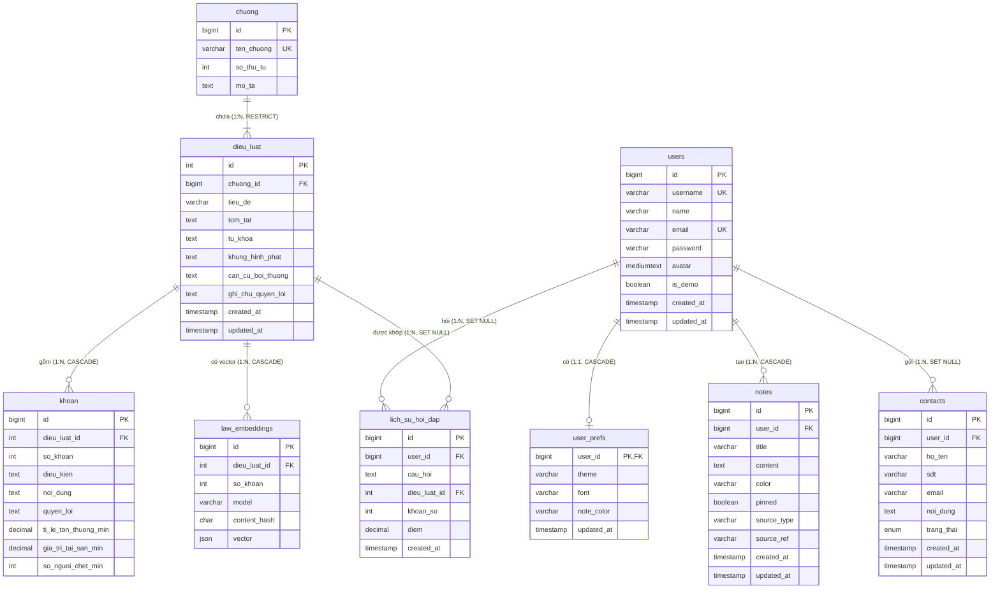

# Thiết kế cơ sở dữ liệu — Hình Sự Tra Cứu

> **Hệ quản trị:** MySQL 8.4 · **Bảng mã:** `utf8mb4` / `utf8mb4_unicode_ci` · **Engine:** InnoDB
> **Nguồn sự thật:** các migration trong `app/api/database/migrations/` (Laravel). Tài liệu này mô tả đúng kết quả của chúng.
> Tên CSDL mặc định `hinh_su`, CSDL test `hinh_su_test`.

## 1. Tổng quan

CSDL gồm 3 phân hệ, 9 bảng nghiệp vụ và vài bảng hạ tầng của Laravel.

| Phân hệ | Bảng | Vai trò |
|---|---|---|
| Người dùng | `users`, `user_prefs`, `sessions` | Tài khoản, tùy chỉnh giao diện, phiên đăng nhập |
| Tương tác | `notes`, `contacts`, `lich_su_hoi_dap` | Ghi chú cá nhân, thư liên hệ, nhật ký hỏi đáp chatbot |
| Tri thức pháp luật | `chuong`, `dieu_luat`, `khoan`, `law_embeddings` | Bộ luật theo chương, điều, khoản và vector ngữ nghĩa |
| Hạ tầng Laravel | `cache`, `cache_locks`, `jobs`, `job_batches`, `failed_jobs`, `migrations` | Cache, hàng đợi, lịch sử migration |

## 2. Sơ đồ thực thể liên kết



## 3. Mô tả bảng

### 3.1 `users`
| Cột | Kiểu | Ghi chú |
|---|---|---|
| `id` | bigint unsigned PK | |
| `username` | varchar(40), unique, null | Tên đăng nhập (đăng nhập được bằng username hoặc email) |
| `name` | varchar(255) | Tên hiển thị |
| `email` | varchar(254), unique | |
| `password` | varchar(255) | Băm bcrypt (`BCRYPT_ROUNDS=12`) |
| `avatar` | mediumtext, null | Ảnh đại diện dạng data URL |
| `is_demo` | boolean, mặc định 0 | Tài khoản demo dùng chung, bị khóa sửa/xóa |
| `remember_token`, `created_at`, `updated_at` | | Chuẩn Laravel |

### 3.2 `sessions`
Phiên đăng nhập lưu ở CSDL (`SESSION_DRIVER=database`): `id` PK, `user_id` (index), `ip_address`, `user_agent`, `payload`, `last_activity` (index).

### 3.3 `user_prefs`
Quan hệ 1:1 với `users` (khóa chính cũng là khóa ngoại, xóa user thì xóa theo).

| Cột | Kiểu | Mặc định |
|---|---|---|
| `user_id` | PK, FK → `users.id` | |
| `theme` | varchar(20) | `system` (`light` / `dark` / `system`) |
| `font` | varchar(10) | `md` (`sm` / `md` / `lg` / `xl`, cỡ chữ ghi chú) |
| `note_color` | varchar(20) | `yellow` |
| `updated_at` | timestamp | |

### 3.4 `notes`
| Cột | Kiểu | Ghi chú |
|---|---|---|
| `id` | bigint PK | |
| `user_id` | FK → `users.id`, CASCADE | Xóa user thì xóa ghi chú |
| `title` | varchar(255) | |
| `content` | text, null | |
| `color` | varchar(20) | Mặc định `yellow`; `auto` là theo tùy chỉnh người dùng |
| `pinned` | boolean | Ghim lên đầu |
| `source_type`, `source_ref` | varchar(50), null | Nguồn khi lưu từ điều luật hoặc chatbot |

Index `idx_notes_user_pinned (user_id, pinned, created_at)` phục vụ danh sách ghi chú.

### 3.5 `contacts`
| Cột | Kiểu | Ghi chú |
|---|---|---|
| `user_id` | FK null, SET NULL | Khách chưa đăng nhập vẫn gửi được |
| `ho_ten` | varchar(100) | |
| `sdt` | varchar(25), null | |
| `email` | varchar(255) | |
| `noi_dung` | text | |
| `trang_thai` | enum(`moi`, `da_tra_loi`) | Mặc định `moi` |

Index: `idx_contacts_status`, `idx_contacts_created`.

### 3.6 `chuong`
`id` PK · `ten_chuong` varchar(255) **unique** · `so_thu_tu` int (index `idx_chuong_stt`) · `mo_ta` text, null.

### 3.7 `dieu_luat`
Khóa chính `id` là **số điều** của Bộ luật (ví dụ 173), không tự tăng.

| Cột | Kiểu | Ghi chú |
|---|---|---|
| `id` | int unsigned PK | Số điều luật |
| `chuong_id` | FK → `chuong.id`, RESTRICT | Không xóa chương còn điều |
| `tieu_de` | varchar(255) | Tên tội danh |
| `tom_tat` | text | |
| `tu_khoa` | text | Từ khóa phục vụ tìm kiếm |
| `khung_hinh_phat` | text | Khung hình phạt tổng quan |
| `can_cu_boi_thuong` | text, null | Căn cứ bồi thường |
| `ghi_chu_quyen_loi` | text, null | |
| `created_at`, `updated_at` | timestamp, null | Chuẩn Laravel |

### 3.8 `khoan`
Mỗi khoản là một mức định khung của một điều. Ràng buộc `uq_dieu_khoan (dieu_luat_id, so_khoan)` không cho trùng khoản trong cùng điều. FK `dieu_luat_id` → `dieu_luat.id`, CASCADE.

| Cột | Kiểu | Ghi chú |
|---|---|---|
| `so_khoan` | int unsigned | |
| `dieu_kien` | text, null | Điều kiện áp dụng khoản |
| `noi_dung` | text | Nội dung khoản |
| `quyen_loi` | text, null | Quyền lợi người bị hại |
| `tu_khoa` | text, null | |
| `ti_le_ton_thuong_min/max` | decimal(5,2), null | Tỉ lệ tổn thương cơ thể (%) |
| `gia_tri_tai_san_min/max` | decimal(12,3), null | Giá trị tài sản |
| `so_nguoi_chet_min/max` | int, null | |
| `cau_hoi_lam_ro` | text, null | Câu hỏi chatbot hỏi lại để chọn khoản |

### 3.9 `lich_su_hoi_dap`
Nhật ký mỗi câu hỏi của chatbot.

| Cột | Kiểu | Ghi chú |
|---|---|---|
| `user_id` | FK null, SET NULL | Xóa user vẫn giữ nhật ký |
| `cau_hoi` | text | |
| `dieu_luat_id` | FK null → `dieu_luat.id`, SET NULL | Điều được chọn (null nếu không khớp) |
| `khoan_so` | int unsigned, null | |
| `diem` | decimal(5,4), null | Điểm khớp |
| `created_at` | timestamp, mặc định hiện tại | Index `idx_lich_su_time` |

### 3.10 `law_embeddings`
Vector ngữ nghĩa cho tìm kiếm trộn (chỉ dùng khi bật `SEARCH_BLEND_ENABLED`).

| Cột | Kiểu | Ghi chú |
|---|---|---|
| `dieu_luat_id` | FK, CASCADE | |
| `so_khoan` | int unsigned, mặc định 0 | 0 là vector của cả điều |
| `model` | varchar(100) | Tên model tạo vector |
| `content_hash` | char(64) | Băm nội dung, để biết khi nào cần tạo lại |
| `vector` | json | |

Ràng buộc `uq_law_embeddings (dieu_luat_id, so_khoan, model)`.

## 4. Quy tắc xóa dữ liệu (khóa ngoại)

| Khi xóa | Hệ quả |
|---|---|
| `users` | `user_prefs`, `notes` bị xóa theo. `contacts`, `lich_su_hoi_dap` giữ lại, `user_id` thành NULL |
| `dieu_luat` | `khoan`, `law_embeddings` bị xóa theo. `lich_su_hoi_dap.dieu_luat_id` thành NULL |
| `chuong` | Bị từ chối nếu còn điều luật thuộc chương |

## 5. Nạp dữ liệu và chạy lại

```bash
docker compose exec app php artisan migrate --seed      # tạo bảng + nạp dữ liệu
docker compose exec app php artisan migrate:fresh --seed # xóa sạch, tạo lại (mất dữ liệu!)
```

- `LawSeeder` nạp chương, điều, khoản từ `app/api/database/data/dieu_luat_data.php` (hiện 9 chương, 18 điều, 61 khoản). Đây là nguồn dữ liệu luật duy nhất.
- `DemoUserSeeder` tạo tài khoản `demo` (`is_demo = 1`), chạy lại không tạo trùng.

## 6. So với thiết kế cũ (bản PHP + XAMPP)

Bản thiết kế đầu tiên có thêm vài bảng và cột đã bị loại khi chuyển sang Laravel, vì chức năng tương ứng ra khỏi phạm vi:

| Đã bỏ | Lý do |
|---|---|
| `login_attempts` | Khóa sau 5 lần sai nay dùng `RateLimiter` của Laravel (cache), không cần bảng riêng |
| `password_resets`, cột `verified` | Bỏ chức năng quên mật khẩu và xác thực email |
| cột `users.role`, `users.is_builtin` | Bỏ trang quản trị; cờ khóa tài khoản demo là `is_demo` |

Tên bảng và cột của phần luật, ghi chú, liên hệ, hỏi đáp được giữ nguyên.
